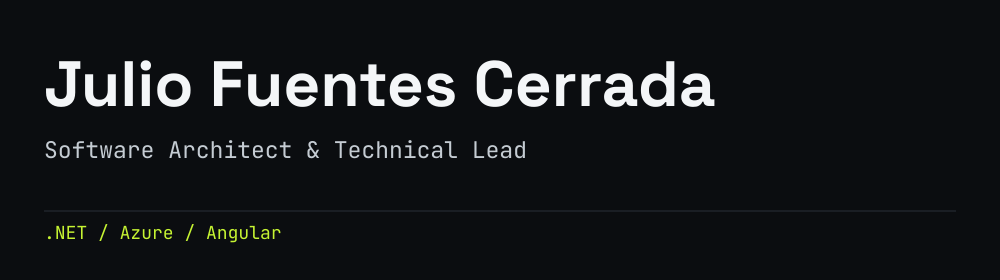
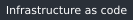
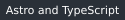
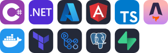
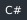
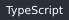
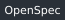

<picture>
  <source media="(max-width: 600px) and (prefers-color-scheme: dark)" srcset="assets/variants/mono/header-compact-dark.svg">
  <source media="(max-width: 600px)" srcset="assets/variants/mono/header-compact-light.svg">
  <source media="(prefers-color-scheme: dark)" srcset="assets/variants/mono/header-dark.svg">
  <source media="(prefers-color-scheme: light)" srcset="assets/variants/mono/header-light.svg">
  
</picture>

[🛠️ Projects](#projects) · [🧰 Technologies](#technologies) · [🤖 How I develop with AI](#how-i-develop-with-ai) · [💼 Experience](#experience)

**I build applications and the platforms that support them.** Over 20 years in software engineering, I have worked across backend and frontend development, architecture, cloud infrastructure and delivery, with a focus on .NET, Angular and Azure.

My work connects business requirements with technical decisions: modeling the domain, defining service boundaries, building APIs and user interfaces, and making systems observable and maintainable. I also help teams improve through code reviews, mentoring and shared engineering practices.

 

## Projects

These projects cover infrastructure, application development, applied AI, data engineering and product delivery.

| Project | Engineering focus |
| :--- | :--- |
| [Steward](#steward--azure-platform-and-delivery) | Azure platform & delivery |
| [Herald](#herald--application-architecture) | Application architecture |
| [Arcana](#arcana--applied-ai-with-evaluation) | Applied AI & evaluation |
| [Archivist](#archivist--data-pipelines-and-classification) | Data pipelines & classification |
| [Pauper Pilot](#pauper-pilot--product-development) | Product development |

### [Steward — Azure platform and delivery](https://github.com/juliofuentescerrada/steward)

A shared Azure platform designed to support multiple applications, with clear ownership boundaries between platform resources and application-specific infrastructure.

    

Platform decisions

OpenTofu and GitHub Actions support OIDC-based delivery, independent application state and resource activation according to need. Operational records cover access checks, recovery exercises and the cost trade-offs of running a small shared platform.

---

### [Herald — Application architecture](https://github.com/juliofuentescerrada/herald)

A tournament management application designed around registration, pairings, results and standings for individuals or teams. Game-specific rules are kept separate from the competition workflow.

    

Architecture &amp; implementation status

Herald brings together the core of my application development experience: domain modeling, a .NET backend, an Angular frontend and the decisions that connect them. Its modular monolith uses vertical slices, module-owned persistence and explicit integration boundaries. PostgreSQL persistence, Wolverine transactional messaging, architecture checks and CI form the implemented foundations; specifications and interactive UI prototypes guide the next steps.

---

### [Arcana — Applied AI with evaluation](https://github.com/juliofuentescerrada/arcana)

A rules assistant for Magic: The Gathering, a card game with a detailed, interconnected ruleset. Arcana retrieves rules and card rulings, generates answers with checkable citations, and can abstain when its sources do not support an answer.

🔗 **Live demo:** [Arcana](https://ca-arcana-web.politehill-c00afc81.northeurope.azurecontainerapps.io/)

    

Retrieval &amp; evaluation

A .NET API, Angular interface and MCP server expose the capabilities. PostgreSQL with pgvector supports retrieval, and Microsoft Foundry provides model inference. Experiments and evaluations document the trade-offs between retrieval quality, citation validity, latency and cost.

---

### [Archivist — Data pipelines and classification](https://github.com/juliofuentescerrada/archivist)

A .NET pipeline that extracts tournament decklists, normalizes events and card identities, and classifies decks into archetypes by similarity.

    

Pipeline &amp; evaluation

The local pipeline separates raw extraction, normalization, reference labels and classification. Calibration and temporal evaluation measure agreement with the reference alongside coverage, making uncertain assignments visible. Data provenance and keyed player hashes are part of the design.

---

### [Pauper Pilot — Product development](https://github.com/juliofuentescerrada/pauper-pilot)

A metagame explorer for Pauper, a Magic: The Gathering format. It helps players explore tournament decks and compare them with their own card collections.

🔗 **Live site:** [pauperpilot.com](https://pauperpilot.com/)

    

Product &amp; delivery

TypeScript ingestion feeds an Astro static site, with Supabase-backed accounts and collections. Automated ingestion, checks and builds support daily updates, bringing together data processing, user-facing features and delivery in a personal product.

## Technologies

My core stack is **.NET, Azure and Angular**, supported by tools chosen for the work at hand.

| Area | Technologies & practices |
| :--- | :--- |
| Application engineering |      |
| Cloud & delivery |      |
| Data |    |
| Applied AI |     |
| AI-assisted development |    |

## How I develop with AI

I use **Codex and Claude Code** as part of my engineering workflow, and **OpenSpec** to connect requirements, design decisions, implementation tasks, and verification. My work also includes helping teams adopt these practices and making useful workflows reusable across an organization.

- **Specifications and context.** Define scope and acceptance criteria, record architectural decisions, and give agents explicit repository instructions. Keep that context with the code so work can continue across sessions.
- **Skills.** Capture repeatable engineering practices as task-specific instructions, including conventions, workflows, and validation steps. This gives agents a consistent starting point for recurring work.
- **Plugins and marketplaces.** Package and distribute reusable capabilities so teams can adopt shared tooling and practices. I have put an internal AI development plugin marketplace in place at the organization level.
- **Harness design.** Treat the environment around the agent as part of the engineering work: context loading, tool access, execution boundaries, feedback from tests, and checks before a change is accepted. The aim is to make the workflow repeatable and its results inspectable.
- **Review and feedback.** Keep changes focused, inspect the implementation, and use tests, static analysis, and CI to check the result. Feed corrections back into specifications and working instructions.

I remain responsible for architecture, trade-offs, and acceptance. My focus is on building a development process that teams can understand, reuse, and improve as the tools evolve.

## Experience

Over 20 years, I have progressed from software development to technical leadership and Principal Engineer responsibilities, working across business applications, digital platforms, and cloud infrastructure.

My experience includes designing .NET systems, building web applications, evolving platforms on Azure, and improving delivery through CI/CD, automated testing, and observability. Code reviews, mentoring, and shared engineering standards have been a consistent part of that work.

I currently work as a Technical Delivery Manager, connecting that engineering background with architecture alignment and delivery across teams.

[Explore my professional background on LinkedIn](https://www.linkedin.com/in/juliofuentescerrada/)

